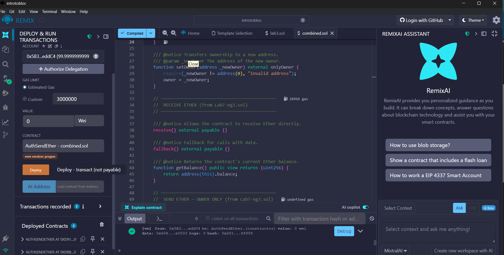

# Solidity Smart Contracts

Smart contracts I wrote while studying **Blockchain & Cryptocurrencies (DFIN402)** at ESLSCA University. They cover access control, sending and receiving Ether, and Solidity data types.

## Contracts

| Contract | What it does |
|---|---|
| [`AuthSendEther.sol`](contracts/AuthSendEther.sol) | Combines an **owner-only authorization** pattern with **receiving and sending Ether**. The deployer becomes the owner and can transfer ownership. Only the owner can move funds. It demonstrates all three transfer methods (`transfer`, `send` and the recommended `call`) |
| [`DynamicArrays.sol`](contracts/DynamicArrays.sol) | Dynamic `uint[]` / `int[]` arrays held in storage |
| [`FixedArrays.sol`](contracts/FixedArrays.sol) | Fixed-size arrays in storage vs. memory |

## Key concepts
- `modifier onlyOwner` for access control
- `receive()` and `fallback()` so the contract can accept Ether
- Why `call{value: ...}("")` is preferred over `transfer`/`send` (the 2300-gas stipend issue)
- Zero-address checks when transferring ownership

## Run it
1. Open [Remix IDE](https://remix.ethereum.org) and paste a contract into a new file.
2. Compile with Solidity **0.8.26+**.
3. Deploy to the *Remix VM*, send some Ether with the **Value** field, and call `sendViaCall`.

**Stack:** Solidity · Ethereum · Remix IDE
